<picture>
  <source media="(max-width: 600px) and (prefers-reduced-motion: reduce)" srcset="assets/night-banner-mobile-static.svg">
  <source media="(prefers-reduced-motion: reduce)" srcset="assets/night-banner-static.svg">
  <source media="(max-width: 600px)" srcset="assets/night-banner-mobile.svg">
  
</picture>

  <a href="https://tianyi-zhang-02.github.io/">Website ↗</a> &nbsp;·&nbsp;
  <a href="https://scholar.google.com/citations?user=46rbYk0AAAAJ">Google Scholar ↗</a> &nbsp;·&nbsp;
  <a href="https://www.linkedin.com/in/tianyi-zhang2002/">LinkedIn ↗</a>

### research/

I'm a Computer Science master's student at **Georgia Tech**, graduating in May 2027.

My interests are **representation learning, LLM post-training, and model / agent evaluation**. I'm especially interested in learning from sparse, noisy feedback—and figuring out whether a model really improves.

### building/

<a href="https://github.com/tianyi-zhang-02/cooking-agi">
<picture>
  <source media="(max-width: 600px) and (prefers-reduced-motion: reduce)" srcset="assets/card-notes-mobile-static.svg">
  <source media="(prefers-reduced-motion: reduce)" srcset="assets/card-notes-static.svg">
  <source media="(max-width: 600px)" srcset="assets/card-notes-mobile.svg">
  
</picture>
</a>

[English](https://tianyi-zhang-02.github.io/cooking-agi/index.en.html) · [中文](https://tianyi-zhang-02.github.io/cooking-agi/)

### off-the-clock/

Road trips, national parks, and [music for the way ↗](https://open.spotify.com/playlist/5mvXtbOcZx8t4gBWIZTFZn).
